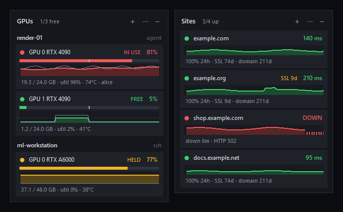

# Changelog

All notable changes to Perch are documented here. The format follows [Keep a Changelog](https://keepachangelog.com/en/1.1.0/), and versions follow [Semantic Versioning](https://semver.org/). Each section below is also published as the notes of its GitHub release.

## [0.2.0] - 2026-11-09

The first public release of **Perch**: discreet, customizable desktop cards that keep watch for you. You can see which GPUs on your machines are free, and whether your websites are up, without opening a single dashboard.

### Highlights

- **Sites card:** uptime, response time, and SSL and domain expiry for the websites you host and manage.
- **GPU card:** free, in use or held, across any number of machines, including who's using each GPU.
- **Your perch:** hatch new cards from a gallery, tweak them, hide them, or let them fly away.
- **One consistent dark design** across every card, dialog and menu.

### Sites card

- **Up or down:** each site is checked every minute (adjustable). It only counts as **down** after 2 failed checks in a row, so a single blip never alerts you.
- **Response time:** a live response-time graph, with failed checks marked in red.
- **Uptime %** for 24 hours, 7 days and 30 days, kept between restarts.
- **Expiry warnings:**
  - days left on the **SSL certificate** and the **domain registration** (the domain date comes from the registry, via RDAP);
  - an amber and then red badge as either gets close.
- **"Must contain" check:** catches a broken deploy that still returns status 200.
- **Notifications:** when a site goes down, when it recovers (with how long it was out), and before a certificate or domain lapses.
- **Shortcuts:**
  - double-click to open a site;
  - right-click to open its admin page or repository, check it now, or pause checks.
- **Hover a site** for the full picture: status code, uptime, average response time, SSL issuer and expiry, domain registrar and expiry, and the last outage.

### GPU card

- **Any number of machines,** reached three ways:
  - the Perch **agent**;
  - **SSH** (nothing to install on the machine);
  - **This PC**.
- **Smart "in use" detection:**
  - a **VRAM threshold**;
  - **utilization averaged over time**, so one spike doesn't flip the state;
  - a **HELD** state for memory that's reserved while the GPU sits idle;
  - a dead zone so GPUs don't flicker between states.
- **Who's using it:** hover a GPU to see its processes, users and memory.
- **History graphs** of VRAM and utilization.
- **"Notify me when free":** right-click a busy GPU to get a notification when it frees up.

### Cards, everywhere

- **Each card is its own floating window,** with its own title, opacity and always-on-top setting. Cards snap to screen edges and to each other.
- **Your perch** shows every card as a tile with its live status. The **hatch gallery** walks you through a quick setup: for Sites, just paste your addresses.
- **The tray icon** shows the worst status across all cards (green, amber or red), and its tooltip summarises them all.
- **Have as many cards as you like,** e.g. one Sites card for client work and another for your own projects.

### Install

1. Download **`Perch.exe`** below.
2. Run it and click **Install**.

Perch installs just for you, with no admin rights needed. It adds a Start-menu entry and an entry in **Settings → Apps**, and can start with Windows.

> Windows SmartScreen may warn about an unrecognized app because the exe isn't code-signed yet. Click **More info → Run anyway**.

- **Without installing:** click **Just run it**, or start it with `Perch.exe --portable`.
- **Scripted installs:** `Perch.exe --install [--no-autostart] [--desktop] [--no-launch]`.

### Upgrading from GPU Watch

Perch replaces earlier GPU Watch builds automatically. It removes the old startup entry, shortcuts and files, and carries your machines and settings over as a GPU card.

### Watching GPUs on other machines (optional)

| Machine | Download | Set up |
|---|---|---|
| Windows | `perch-agent.exe` + `install_agent_windows.ps1` | run the script from an Administrator PowerShell |
| Linux | `perch_agent.py` + `install_agent_linux.sh` | `sudo ./install_agent_linux.sh` |
| Any machine you can SSH into | nothing | choose **SSH** when adding the machine |

The agent is read-only and only reports GPU stats and process names. Run it on a trusted network, or use SSH for machines reachable over the internet.

### Requirements

- Windows 10 or 11 (64-bit) for the app.
- An NVIDIA driver with `nvidia-smi` on GPU machines.
