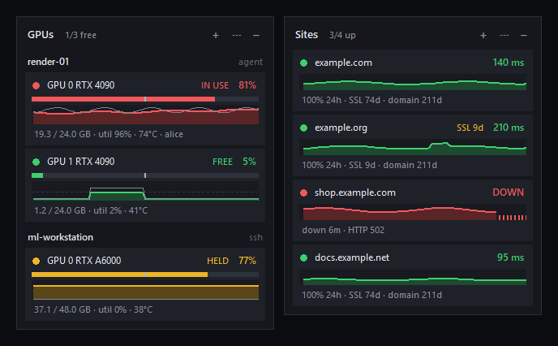
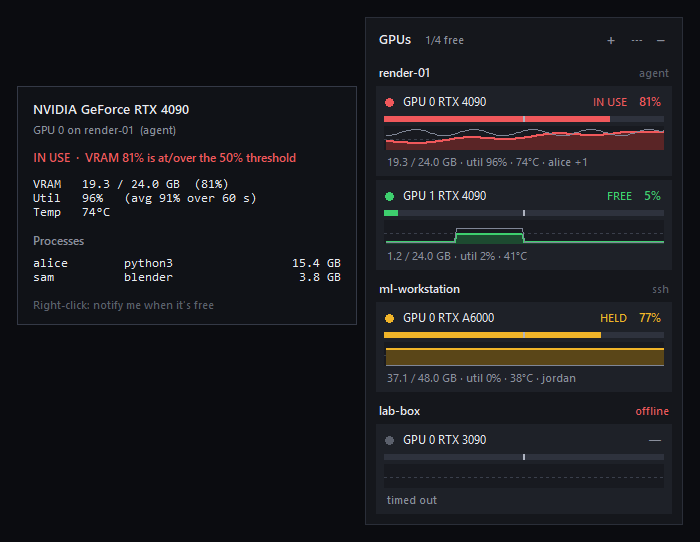

# Perch

Perch puts small cards on your Windows desktop that show whether your GPUs are free and whether your websites are up. Each card is its own window. You can move it, hide it, change its opacity, or add more cards.



## Sites card

Add the websites you look after, and the card checks each one every minute.

- A site is marked down only after 2 failed checks in a row, so a single hiccup doesn't set it off.
- Each row shows the response time and a graph of the last hour. Failed checks show up as red marks.
- It shows how many days are left on the SSL certificate and the domain registration, and warns you when either is getting close. Domain dates come from the registry using RDAP.
- You can give a site some text that has to be on the page. If it's missing, the site counts as down. This catches broken deploys that still return a 200.
- You get a Windows notification when a site goes down, when it comes back, and when a certificate or domain is about to expire.
- Double-click a site to open it. Right-click it to open its admin page or repo, check it now, or pause it.
- Hover over a site to see its uptime over 24 hours, 7 days and 30 days, its average response time, SSL and domain details, and the last outage.

## GPU card

Shows which NVIDIA GPUs on your machines are free, in use or held.

You can add as many machines as you want and choose which GPUs to show from each. Perch can reach a machine in three ways:

- through the Perch agent, a small read-only service you run on the machine;
- over SSH, with nothing to install;
- directly, for the PC Perch is running on.

A GPU counts as in use when its VRAM is over a threshold (50% by default) or its utilization has been high for the last minute. It's marked held when the VRAM is taken but the GPU has been idle for 10 minutes, which usually means a notebook or cached model someone forgot about. Near a threshold, a small buffer stops a GPU from flipping back and forth between states.

Hover over a GPU to see which processes and users are on it. Right-click a busy GPU and Perch will notify you when it frees up.



## Adding and removing cards

Open **All cards** from the tray icon or from a card's **⋯** menu. It lists every card with its current status. From there you can open a card's settings, hide or show it, or remove it.

To add a card, click **Add a card**, pick a type, give it a name and click **Add card**. For a Sites card you can paste your addresses right there, one per line. You can have as many cards as you want, for example one for client sites and one for your own.

The tray icon is green when everything is fine, amber when something needs attention soon (like a certificate about to expire, or every GPU being busy), and red when something is down. Hover over it for a summary.

## Install

1. Download `Perch.exe` from the [latest release](https://github.com/Rowson3D/perch/releases/latest).
2. Run it and click **Install**.

It installs for your user only, so you don't need admin rights. It adds a Start menu shortcut and an entry in Installed apps, and it can start with Windows.

The exe isn't code-signed yet, so Windows SmartScreen may warn you the first time. Click **More info**, then **Run anyway**.

To use it without installing, click **Just run it**, or start it with `Perch.exe --portable`. For a silent install, use `Perch.exe --install` with `--no-autostart`, `--desktop` or `--no-launch` as needed.

If you used GPU Watch before, Perch removes it and keeps your machines and settings.

## Adding GPU machines

Click **+** on a GPU card. Choose how to connect, enter the IP or hostname, click **Find GPUs**, tick the ones you want, and click **Add**.

| Connect via | Use it for | What it needs |
|---|---|---|
| This PC | the computer Perch is running on | nothing |
| SSH | Linux machines, cloud servers, anything you can already `ssh` into | key-based login, so `ssh user@host` works without a password prompt |
| Agent | machines where you don't want to use SSH, including Windows | the Perch agent running on port 9123 |

### Installing the agent

On Linux, this installs it as a service that starts on boot:

```bash
sudo ./install_agent_linux.sh          # optional: port number, default 9123
curl http://localhost:9123/gpus         # check it's running
```

On Windows, put `perch-agent.exe` and `install_agent_windows.ps1` in the same folder and run this from an Administrator PowerShell:

```powershell
powershell -ExecutionPolicy Bypass -File .\install_agent_windows.ps1
```

That adds a startup task and opens the port on private and domain networks.

The agent only reports GPU stats and process names. It can't change anything, but it has no password either, so only run it on a network you trust. For machines on the internet, use SSH instead.

## GPU states

| State | Meaning |
|---|---|
| FREE | VRAM is under the threshold and utilization is low |
| IN USE | VRAM is over the threshold, or utilization has been high |
| HELD | VRAM is over the threshold, but the GPU has been idle for the held period |
| offline | the machine couldn't be reached; the card shows why |

You can change the thresholds and time windows in the card's settings.

## Tips

- Drag a card anywhere. It snaps to the edges of the screen and to other cards.
- Right-click a row for things you can do with it. Right-click anywhere else on a card, or click **⋯**, for the card's menu.
- **+** adds a machine or site to the card, and **–** hides the card.
- Click the tray icon to show or hide all cards.

Settings are saved in `%APPDATA%\Perch\config.json`, and site history in `%APPDATA%\Perch\state\`.

## Uninstall

Go to Settings → Apps → Installed apps → Perch → Uninstall, or run `Perch.exe --uninstall`. It asks whether you want to keep your saved machines and sites.

## Changelog

See [CHANGELOG.md](CHANGELOG.md). Each version's section is also used as the notes for its GitHub release.

## Planned

- More card types: this PC's CPU, memory, disk and network; GitHub builds and pull requests; Docker.
- A way to make your own card from a website, an API or a script.
- More display options: sitting behind your windows, click-through, hiding while a game is fullscreen, and saved layouts.

## Adding a card type

Each card type is one class in `perch/cards/`. Subclass `Card` from `perch/cards/base.py`, implement `render`, `update_view`, `start`, `status`, `menu_items` and `settings_rows`, then register it in `perch/cards/__init__.py`.

The base class handles the window, dragging, menus, the settings window and hover details, so a new card looks and works like the others. The colors, fonts and shared components are described in [docs/design-system.md](docs/design-system.md).

## Building from source

You need Windows and Python 3.10 or newer.

```powershell
powershell -ExecutionPolicy Bypass -File scripts\build.ps1
```

This sets up `.venv`, runs the linter and tests, and builds `dist\Perch.exe` and `dist\perch-agent.exe` with PyInstaller.

To run it from source:

```powershell
pip install -e ".[dev]"
python -m perch
```

The code is checked with ruff (`ruff check .` and `ruff format .`).

To release a new version, bump `__version__` in `perch/__init__.py`, add a section for it to `CHANGELOG.md`, and push a tag like `v0.2.1`. GitHub Actions builds the exes and publishes the release with that section as its notes. If the section is missing, the build fails.

## License

[MIT](LICENSE)
